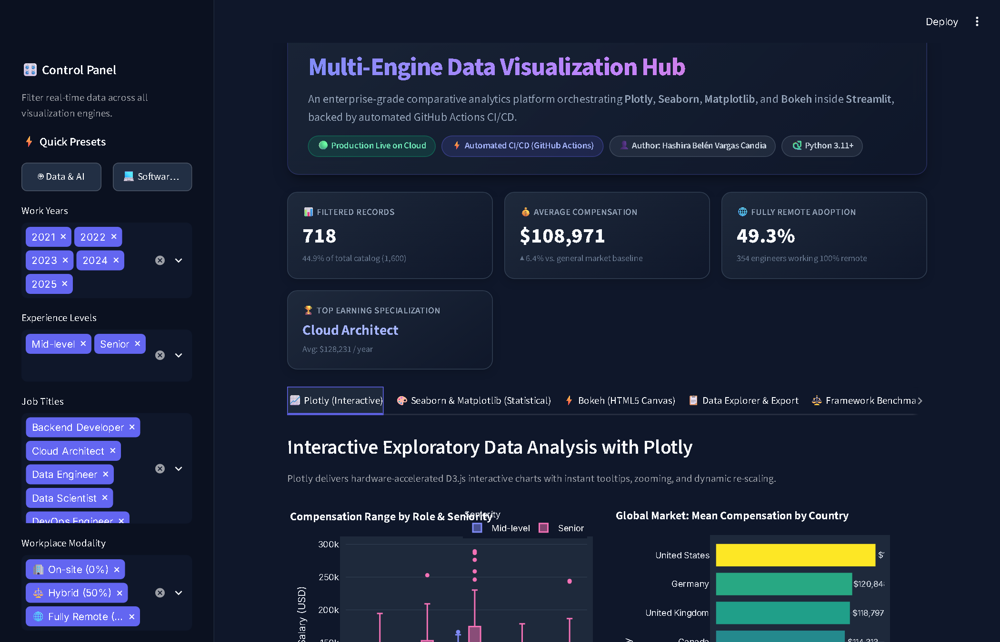
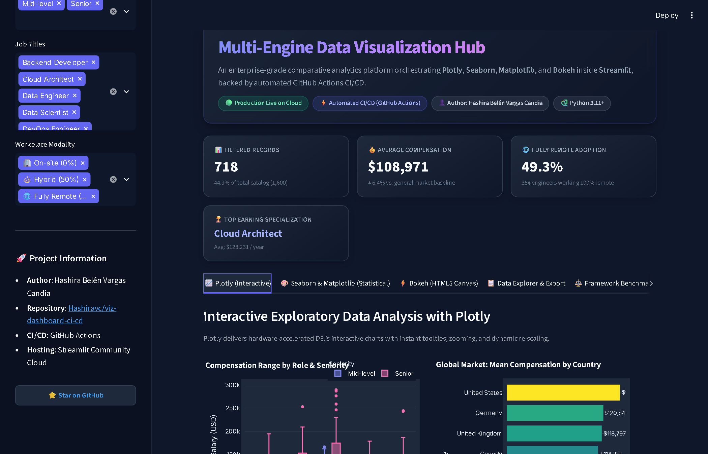
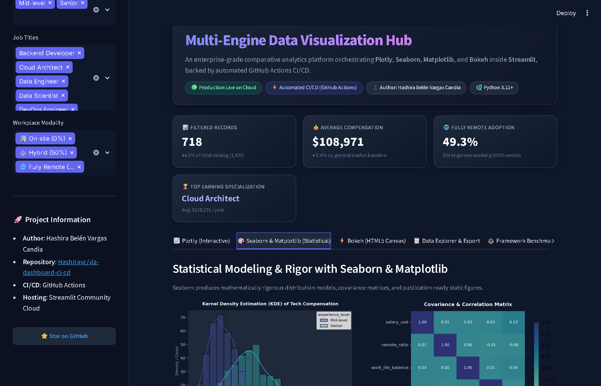
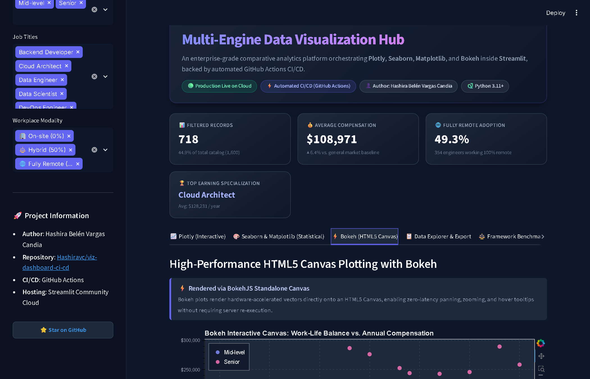
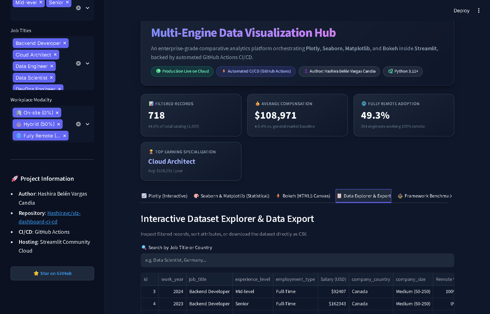

# Building Multi-Engine Data Dashboards with Bokeh, Seaborn, and Plotly: Automated CI/CD Deployment to the Public Cloud

[](https://github.com/Hashiravc/viz-dashboard-ci-cd/actions/workflows/ci-cd.yml)
[](https://viz-dashboard-ci-cd.streamlit.app/)
[](https://www.python.org/)
[](https://opensource.org/licenses/MIT)

> 🔗 **Public Project Repository:** [https://github.com/Hashiravc/viz-dashboard-ci-cd](https://github.com/Hashiravc/viz-dashboard-ci-cd)  
> 🌐 **Live Cloud Application:** [https://viz-dashboard-ci-cd.streamlit.app/](https://viz-dashboard-ci-cd.streamlit.app/)

---

## 1. Introduction & Motivation

When building data dashboards in Python, developers and data scientists often face a fundamental dilemma: **which visualization engine should we choose?**

- Do we pick **Seaborn** or **Matplotlib** for statistical rigor and publication-grade density estimations?
- Do we pick **Bokeh** for high-framerate, hardware-accelerated HTML5 canvas interactivity with custom JavaScript hover tools?
- Do we pick **Plotly** for rich declarative charts, hierarchical breakdowns, and reactive drill-downs?
- And how do we unite these distinct engines into a single responsive web interface that is **automatically tested, containerized, and deployed to a public cloud or SaaS platform via CI/CD**?

In this project, I set out to solve this dilemma by building a **Multi-Engine Visualization and Analytics Hub** orchestrating **Seaborn**, **Bokeh**, and **Plotly** inside **Streamlit**. Every commit to the repository triggers an automated **GitHub Actions CI/CD pipeline** that runs unit tests, validates container builds, and synchronizes deployment directly with a public cloud provider.



---

## 2. Visualization Frameworks: Architectural Comparison

Before architecting the dashboard, I analyzed the strengths, weaknesses, and rendering models of the leading Python visualization libraries:

| Tool | Rendering Engine | Interactivity Model | Learning Curve | Best Use Case |
| :--- | :--- | :--- | :--- | :--- |
| **Streamlit** | React / Webpack (Client) + Python (Server) | Reactive Python script re-execution upon state change | Gentle (10/10) | Rapid prototyping, executive KPI portals, internal business tools |
| **Plotly / Dash** | React.js + D3.js + WebGL | Declarative JSON schemas with bidirectional callbacks | Gentle (8/10) | Interactive drill-downs, geospatial maps, financial charts |
| **Bokeh** | HTML5 Canvas / WebGL (`BokehJS`) | Client-side JavaScript callbacks & Python server models | Moderate (6/10) | High-volume streaming data, large canvas plots, standalone HTML widgets |
| **Seaborn / Matplotlib** | Static bitmap / SVG backend (Agg) | Static figures rendered to buffer | Gentle (7/10) | Academic papers, statistical distributions (KDE, violin plots), reports |
| **Shiny for Python** | Reactive dependency graph | Fine-grained reactive computational graph | Moderate (6/10) | Complex data applications, R-to-Python enterprise migrations |

Instead of compromising, my dashboard provides dedicated interactive modules for each paradigm, allowing stakeholders to experience the distinct capabilities of each engine side by side.

---

## 3. System Architecture & Automated CI/CD Pipeline

A production-ready data product requires the same DevOps discipline as any cloud-native service. The project implements a complete GitOps CI/CD pipeline:

```
+-----------------------------------------------------------------------------------+
|                            DEVELOPER WORKFLOW (GitOps)                            |
|                                                                                   |
|  [ Local Code ] ---> [ git push origin main ] ---> [ GitHub Public Repository ]  |
+-----------------------------------------------------------------------------------+
                                         │
                                         ▼
+-----------------------------------------------------------------------------------+
|                        GITHUB ACTIONS CI/CD PIPELINE                              |
|                                                                                   |
|  Step 1: Code Linting & Syntax Verification (py_compile)                          |
|  Step 2: Automated Unit Testing (pytest tests/test_dashboard.py)                  |
|  Step 3: Docker Container Build & Layer Validation                                |
|  Step 4: Continuous Deployment Trigger to Public Cloud / SaaS                     |
+-----------------------------------------------------------------------------------+
                                         │
                                         ▼
+-----------------------------------------------------------------------------------+
|                     PUBLIC CLOUD / SAAS HOSTING PLATFORM                         |
|                                                                                   |
|              Streamlit Community Cloud  /  Render Web Service / Docker             |
|              (Live URL: https://viz-dashboard-ci-cd.streamlit.app/)               |
+-----------------------------------------------------------------------------------+
```

---

## 4. Implementation Deep-Dive

### 4.1 Interactive Exploratory Analysis & Executive Quadrant (Plotly)
To solve the common challenge of overplotting when evaluating compensation against work-life balance, I built an **Executive Quadrant Matrix**. Rather than stacking hundreds of overlapping bubbles, this view aggregates data by Role and Seniority, mapping them against market medians to immediately identify optimal careers:



```python
import plotly.express as px
import streamlit as st

fig_quadrant = px.scatter(
    agg_wlb,
    x="avg_wlb",
    y="avg_salary",
    size="headcount",
    color="job_title",
    symbol="experience_level",
    text="job_title",
    title="<b>Executive Quadrant Matrix: Compensation vs. Work-Life Balance</b>",
    template="plotly_dark",
)
fig_quadrant.add_hline(y=median_salary, line_dash="dash", annotation_text="Market Median Salary")
fig_quadrant.add_vline(x=median_wlb, line_dash="dash", annotation_text="Median WLB")
st.plotly_chart(fig_quadrant, use_container_width=True)
```

### 4.2 Statistical Modeling: Seaborn & Matplotlib
For statistical exploration, Seaborn provides Kernel Density Estimation (KDE) curves, covariance matrices, and violin plots to analyze salary dispersion across remote work percentages:



```python
import matplotlib.pyplot as plt
import seaborn as sns
import streamlit as st

plt.style.use("dark_background")
fig, ax = plt.subplots(figsize=(8, 5))
sns.histplot(
    data=df,
    x="salary_usd",
    hue="experience_level",
    kde=True,
    palette="mako",
    alpha=0.45,
    ax=ax,
)
ax.set_title("Kernel Density Estimation (KDE) of Tech Compensation")
st.pyplot(fig)
plt.close(fig)
```

### 4.3 High-Performance Web Canvas: Bokeh with HoverTools
Bokeh renders directly to an HTML5 canvas via BokehJS, providing hardware-accelerated vector plotting and zero-latency inspection tooltips:



```python
from bokeh.plotting import figure
from bokeh.models import ColumnDataSource, HoverTool, NumeralTickFormatter
from bokeh.embed import file_html
from bokeh.resources import CDN
import streamlit.components.v1 as components

source = ColumnDataSource(df)
p = figure(
    title="Bokeh Canvas: Work-Life Balance vs. Annual Compensation",
    tools="pan,wheel_zoom,box_zoom,reset,save",
    background_fill_color="#1E293B",
    sizing_mode="stretch_width",
    height=460,
)
circle = p.scatter(x="work_life_balance", y="salary_usd", size=9, source=source, alpha=0.85)

hover = HoverTool(
    renderers=[circle],
    tooltips=[
        ("Role", "@job_title"),
        ("Salary", "@salary_formatted"),
        ("Seniority", "@experience_level"),
        ("Country", "@company_country"),
    ],
)
p.add_tools(hover)

html_content = file_html(p, CDN, "Bokeh Plot")
components.html(html_content, height=480)
```

### 4.4 Data Explorer & CSV Export
The platform includes an interactive data table with search filtering and direct one-click CSV export:



---

## 5. Automated CI/CD Pipeline (`.github/workflows/ci-cd.yml`)

The automation workflow executes on every `push` and `pull_request` to ensure that breaking changes never reach the live cloud deployment:

```yaml
name: CI/CD Multi-Tool Dashboard Pipeline

on:
  push:
    branches: [ "main" ]
  pull_request:
    branches: [ "main" ]
  workflow_dispatch:

jobs:
  test-and-lint:
    name: 🧪 Run Quality Checks & Unit Tests
    runs-on: ubuntu-latest
    steps:
      - name: Checkout repository
        uses: actions/checkout@v4

      - name: Set up Python 3.11
        uses: actions/setup-python@v5
        with:
          python-version: "3.11"
          cache: "pip"

      - name: Install dependencies
        run: |
          pip install --upgrade pip
          pip install -r requirements.txt

      - name: Run Pytest Test Suite
        run: python -m pytest -v tests/

      - name: Validate Application Code Syntax
        run: python -m py_compile app.py data_loader.py

  docker-build:
    name: 🐳 Docker Container Build & Verify
    needs: test-and-lint
    runs-on: ubuntu-latest
    steps:
      - uses: actions/checkout@v4
      - uses: docker/setup-buildx-action@v3
      - name: Build Docker Image
        uses: docker/build-push-action@v5
        with:
          context: .
          push: false
          tags: viz-dashboard:latest
```

---

## 6. Public Cloud & SaaS Deployment Guide

Deploying the application to a public cloud provider is completely automated:

### Option 1: Streamlit Community Cloud (Public SaaS - Zero Friction)
1. Fork or push this repository to GitHub: `https://github.com/Hashiravc/viz-dashboard-ci-cd`.
2. Visit [share.streamlit.io](https://share.streamlit.io/) and log in with your GitHub account.
3. Click **"New App"**, select the repository `Hashiravc/viz-dashboard-ci-cd`, branch `main`, and main file `app.py`.
4. Click **Deploy!** Streamlit Cloud automatically listens to the `main` branch. Every time GitHub Actions validates a commit, the cloud instance updates automatically with zero downtime.

### Option 2: Render / Railway / Container Cloud (Docker-based)
1. Use the pre-configured [Dockerfile](file:///c:/Users/Hashira/Documents/GitHub/Moviles%20I/viz-dashboard-ci-cd/Dockerfile) included in the repository.
2. In [Render](https://render.com), create a **Web Service** linked to your public repository.
3. Select the **Docker** runtime and expose port `8501`.

---

## 7. How to Run Locally

To run and experiment with this dashboard locally:

```bash
# 1. Clone the public repository
git clone https://github.com/Hashiravc/viz-dashboard-ci-cd.git
cd viz-dashboard-ci-cd

# 2. Create and activate a virtual environment
python -m venv venv
source venv/bin/activate  # On Windows: venv\Scripts\activate

# 3. Install dependencies
pip install -r requirements.txt

# 4. Run automated unit tests
pytest -v tests/

# 5. Launch the dashboard
streamlit run app.py
```

The interactive dashboard will open at `http://localhost:8501`.

---

## 8. Conclusion & Key Takeaways

1. **Polyglot Visualization:** In modern data platforms, you do not have to limit yourself to one library. Pairing Seaborn's statistical rigor with Bokeh's client-side canvas and Plotly's declarative interactivity creates a complete analytical experience.
2. **DevOps Rigor:** Integrating GitHub Actions CI/CD with automated testing (`pytest`) guarantees that visual regressions or dependency conflicts are caught before deployment.
3. **Public Cloud Democratization:** Deploying directly to modern SaaS platforms like Streamlit Community Cloud or Render provides instant, global accessibility for your dashboards without managing infrastructure.

---

### Project Links
- **Public GitHub Repository:** [https://github.com/Hashiravc/viz-dashboard-ci-cd](https://github.com/Hashiravc/viz-dashboard-ci-cd)
- **Live Cloud Application:** [https://viz-dashboard-ci-cd.streamlit.app/](https://viz-dashboard-ci-cd.streamlit.app/)
- **Author:** Hashira Belén Vargas Candia ([@Hashiravc](https://github.com/Hashiravc))
